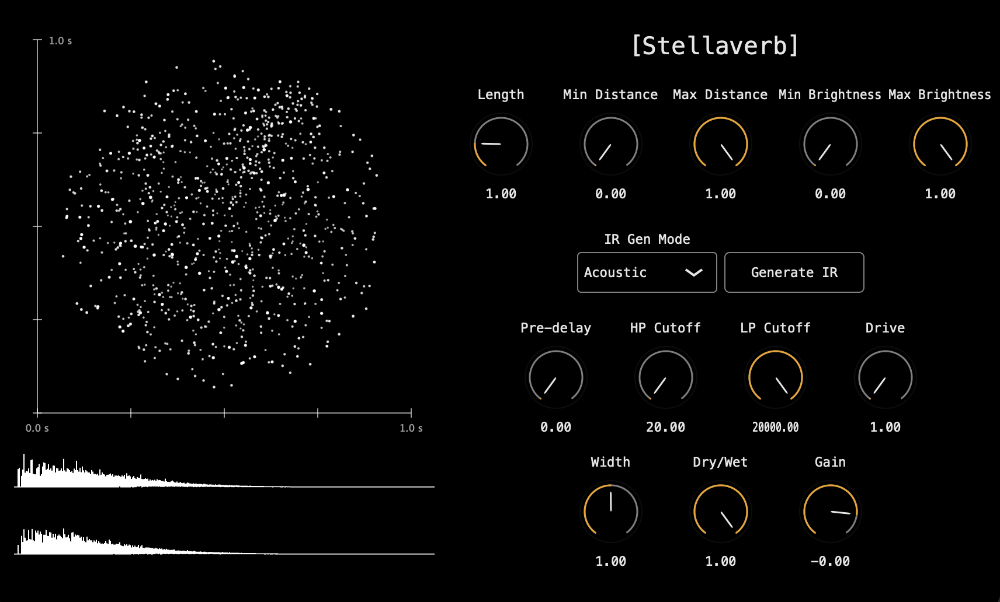

## Stellaverb

Inspired by [Katsuhiro Chiba's Max MSP patch](https://audiooo.com/stellaverb), Stellaverb is a convolution reverb plugin that transforms astronomical data into unique reverberation textures. Drawing from the ESA Gaia Star Catalogue, it explores the idea of simulating how sound might propagate to distant stars and return, while also enabling more abstract, creative reverbs shaped by stellar properties such as distance, brightness, and position.

This project was developed as the final assignment for the ECS7012 Music and Audio Programming module at Queen Mary University of London.

## Demo Video

Here is a short demo video of what the plugin sounds like.

https://github.com/user-attachments/assets/cb92aee9-d773-4f54-8f14-84a707983d79

## Features 

The core of the plugin is its ability to generate an impulse response (IR) using the star data based on the user's settings, then convolving the input signal with the generated IR. Each star is mapped to a sample in the IR based on its distance, position and brightness. 

The plugin has 3 modes, 5 IR generation parameters, and 7 post-processing effects. 

### Modes
Modes are different mapping algorithms used when converting star data into impulse responses.
- Acoustic 
    - Meant to simulate the acoustic effect of sound propagating to the stars and back
    - Distance of each star is mapped to delay time and attenuation, closer stars are louder while further stars are quieter
    - Position of each star is mapped to stereo panning
    - Same as original Stellaverb Max MSP patch 
- Reverse: 
    - Opposite of Acoustic where further stars are louder and closer stars are quieter
    - Distance of each star is mapped to delay time and attenuation, closer stars are quieter while further stars are louder
    - Position of each star is mapped to stereo panning 
- Sustain: 
    - Brightness of each star is mapped to amplitude (loudness)
    - Distance of each star is mapped to delay time
    - Position of each star is mapped to stereo panning 

### IR Generation Parameters
These are parameters that control which stars are used when generating the IR and the length of the generated IR.
- Length - length of the generated IR in seconds
- Min Distance - minimum distance of the stars used in IR generation (stars closer than Min Distance will be filtered out)
- Max Distance - maximum distance of the stars used in IR generation
- Min Brightness - minimum brightness of the stars used in IR generation
- Max Brightness - maximum brightness of the stars used in IR generation

### Other Processing Effects
These are standard processing effects found in most reverb plugins. 
- Pre-delay - controls the amount of time between the original dry sound and the onset of the reverb effect
- Highpass Cutoff - controls the threshold where the frequencies below it begins to be reduced in amplitude
- Lowpass Cutoff - controls the threshold where the frequencies above it begins to be reduced in amplitude
- Drive - controls the amount of drive in tanh saturation
- Width - controls the amount of mid side widening 
- Dry/Wet - controls the balance between the original signal and the convolved signal
- Gain - controls the gain of the final output signal 

## Further Information
More detailed information about the development process and challenges can be found in the [final report](./submission/MAP_A3_FinalProject_Report.pdf). 
